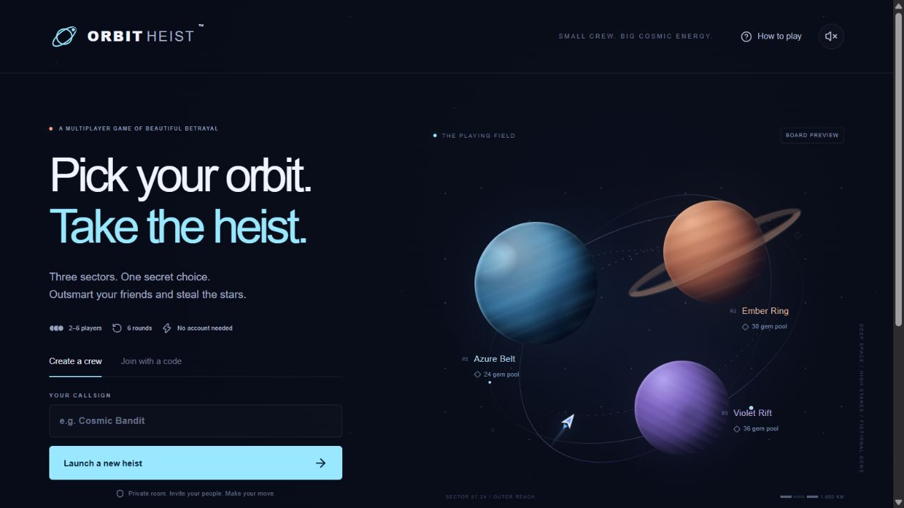

# Orbit Heist

An AI-assisted social space-strategy game for 2–6 players, created for Shyam Panwar's Handshake multiplayer game mission.

[Play the public game](https://orbit-heist.shivamgupt4880.chatgpt.site)

## Play

1. Choose a callsign and create a crew.
2. Share the room code or invite link. Other players join from their own phones or laptops.
3. When at least two players are ready, the host starts the game.
4. Each round, secretly pick one of three sectors. Pilots in the same sector split its crystal pool, rounded down.
5. A storm pays zero unless you use a shield. Each pilot has two shields for the six-round game.
6. Lock your choice before the 45-second deadline. The highest crystal total after round six wins. Rematch starts a fresh lobby.

The game uses fictional crystals, not money. Nicknames should not contain personal information.

## Flight School edition

Solo visitors can play a complete local training match against three clearly labelled simulated rivals. Kestrel prefers safer routes, Echo pursues richer pools, and Rook adapts to previously revealed traffic. Rivals commit before the human chooses and never inspect the current human move or future storm outcomes. Training uses the same scoring engine as multiplayer, resets on refresh and never creates a public room.

The flight computer explains solo/shared payouts and displays previous-round traffic. Every finished match has a round-by-round score chart, replay controls, a personal debrief derived from actual outcomes, and a copyable flight report. No simulated opponents are presented as real players.

## Implementation

Vinext/React frontend, Cloudflare Worker API and D1 persistence. A revision-checked compare-and-swap protects simultaneous room updates. Server time and hidden storm rolls determine outcomes. Public room projections omit opponent choices until reveal, future storm results, and token hashes. Session credentials are isolated per browser tab and survive refresh in that tab. Invite links contain only a room code. Rooms expire after two hours.

Screens synchronize through periodic HTTP polling; no WebSocket server is claimed or required.

## Local development

Requires Node.js >=22.13 and npm. Install with `npm ci`. The committed Drizzle migration creates the room table; do not run schema creation from request handlers.

Build with `npm run build` to generate `dist/server/wrangler.json`. Apply the committed SQL to the local D1 preview with:

    node --import ./scripts/sites-env.mjs ./node_modules/wrangler/bin/wrangler.js d1 execute DB --local --config dist/server/wrangler.json --persist-to .wrangler/state --file drizzle/0000_swift_random.sql

Start with `npm run dev -- --port 5173 --hostname 127.0.0.1`. Local and hosted databases are separate.

## Checks

    node --test tests/game.test.mjs qa/adversarial-engine.test.mjs
    node qa/http-smoke.mjs http://127.0.0.1:5173
    node node_modules/typescript/bin/tsc --noEmit --pretty false
    npm run build

The HTTP smoke test is for an owned development preview; it creates disposable game rooms and performs full multiplayer rounds. See `BUILD_NOTES.md` for the real host-recovery bug and its regression. Validation evidence and screenshots are kept outside the source checkout.

## Hosting

This export keeps the D1 binding (`DB`) in `.openai/hosting.json` but deliberately omits the original owner's Site identity. Local development uses an isolated D1 database and does not need that identity. To deploy your own copy with Sites, register a new Site and persist its returned project ID using the supported Sites workflow. Do not reuse someone else's Site ID or commit credentials, local databases or source-write tokens.

The build uses Vinext, Vite and Cloudflare Workers. The committed framework helpers and third-party license notices are retained so a clean clone can build. `npm test` runs the engine/API regression and adversarial suites without external services. CI additionally installs the locked dependencies, typechecks and builds; browser/production smoke tests are separate.
